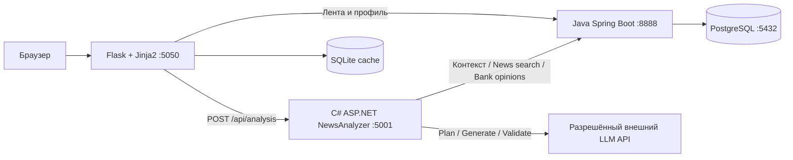

# Alfa Insight — персонализированная новостная аналитика для крупного бизнеса

**Команда:** «Бригада» · **Кейс:** «Новостная аналитика для принятия бизнес-решений» (Альфа-Банк / Changellenge, 2026)  
**Состояние:** хакатонный прототип · **Версия сдачи:** впишите зафиксированный Git commit / tag после проверки (см. раздел «Сдача»).

Alfa Insight помогает руководителю предприятия не просто прочитать новость, а понять, **почему она значима именно для его должности и бизнеса**, какие **риски, возможности и следующие действия** возникают. Прототип совмещает контекст синтетического клиента, новостные материалы, доступную банковскую аналитику и собственную многошаговую агентную обработку. Это **демонстрационный интерфейс**, а не подключение к реальному «Альфа-Бизнесу».

> **Два режима данных.** Чистый локальный запуск использует специально созданный маленький синтетический набор (`db/init/02_demo_seed.sql`), позволяющий проверить регистрацию, персональную ленту и агентный анализ. Он не включает организаторские CSV или настоящие аналитические отчёты Альфа-Банка. Для проверки банковской экспертной позиции загрузите разрешённые организатором материалы в `ai_features_alfabankopinion`. Не приписывайте демонстрационным текстам статус официального мнения банка.
>
> **Настоящий AI требует доступ к внешнему LLM API и действующие ключи.** Изолированный офлайн-режим AI здесь не реализован. Без ключей нельзя честно обещать прохождение полного end-to-end сценария.

## 1. Возможности и ограничения

| Функция | Состояние и детали |
| --- | --- |
| Регистрация, вход, смена профиля | Реализованы в Flask; учетные записи хранятся в PostgreSQL с хешами паролей. Регистрация требует существующий `F_uid`. |
| Ролевой контекст | `CEO`, `CFO`, главный бухгалтер, руководитель казначейства. Один человек может быть связан с компанией через `person_company_links`. |
| Новостная лента | Java выбирает новости по ролевым порогам `finance_importance`/`business_importance`, а также по высокой `global_importance`. **В текущем endpoint нет полного многофакторного LLM-ранжирования по каждому признаку компании**. |
| Просмотр статьи | Статья открывается до AI-анализа. Flask хранит список показанных новостей, чтобы не допускать случайные ID и избежать повторного выбора ленты при клике. |
| Интеллектуальная интерпретация | C#-агент: сбор контекста → планирование → поиск связанных новостей → банковские материалы → генерация → валидация → до одного исправления. |
| Обоснованность | `AnalysisResult` с `claims`, типами `fact`/`inference`/`bank_opinion` и `evidenceIds`; наличие источников проверяется программно, содержание — LLM-валидатором (он не гарантирует абсолютную фактическую точность). |
| Банковская позиция | Поле `bankPerspective` может быть `null`; материалы банка используются только при наличии записей, а отбор пока ограничен ранними записями, не полноценным тематическим RAG. |
| Кеш | SQLite в volume Flask: feed TTL 10 минут, анализ по ключу пользователя, роли, `f_uid` и новости. |
| Трассировка | Есть оперативный `AnalysisState.ExecutionLog`, но **постоянная история сессий пока не сохраняется**. Ссылки `evidenceIds` отдаются клиенту. |
| Уточняющие вопросы | Отдельный интерфейс follow-up вопросов **не реализован**. |
| Безопасность | Базовая авторизация во Flask и запрет статьи вне выданной ленты; **прямой C# API не авторизует `userId`**, поэтому порты сервисов привязаны к localhost. Для реального развёртывания нужна сервисная авторизация и CSRF-защита. |

## 2. Архитектура



**`frontend/`:** Python 3.12, Flask, Jinja, psycopg. **`company-service/`:** Java 21, Spring Boot 4.1.1, JPA/JDBC, PostgreSQL, PDFBox. **`news-analyzer/`:** .NET 9 / ASP.NET Core, самостоятельно реализованный `AgentOrchestrator`, `AnalysisPlanner`, `AnalysisValidator`, `EvidenceCatalogService`, `EvidenceReferenceValidator`. **`db/init/`:** схема и строго синтетическая стартовая выборка. **`compose.yaml`:** единый запуск четырёх контейнеров.

### Как агент работает с инструментами

1. Получает `userId`/`newsId` из Flask и запрашивает профиль человека, роль, связанные компании и новость через Java API.
2. `AnalysisPlanner` определяет до двух дополнительных поисковых запросов; при недоступном/пустом плане допускается деградация без новых результатов, которая уменьшает полноту исследования.
3. Java `/api/news/search` выполняет полнотекстовый поиск PostgreSQL по новостям; контекст накапливается в `AnalysisState`.
4. Java `/api/opinions/get` отдаёт материалы банка (в текущем прототипе — первые 20; агент берёт ограниченное подмножество). Нет гарантии тематического соответствия.
5. `AnalysisService` создаёт типизированный `AnalysisResult`, в котором отдельно выделены `bankPerspective`, `claims`, риски, возможности и следующий шаг.
6. `EvidenceReferenceValidator` проверяет идентификаторы и типы ссылок; `AnalysisValidator` оценивает логическую и фактологическую обоснованность, инициирует ограниченную корректирующую итерацию при ошибках.
7. API возвращает `analysis`, `sources`, `hasCompany`, `contextNotice`; Flask показывает анализ и каталог процитированных источников. Если связанная компания не найдена, пользователь видит предупреждение об ограниченности контекста.

Это реализует планирование, инструменты, общий контекст и самопроверку (кейс, стр. 7). Не следует трактовать LLM-валидацию как независимую проверку первоисточника, а наличие `SourceId` как доказательство истинности тезиса.

## 3. Воспроизводимый локальный запуск

### Требования

- Git, Docker Engine/Desktop и Docker Compose v2; доступ к интернету для сборки образов и вызовов разрешённого LLM API.
- Ориентировочно 4–8 ГБ свободной памяти, свободные локальные порты **5050, 5001, 8888, 5432** (при необходимости измените публикацию портов).
- Два действительных API-ключа конкурса — **либо один ключ, если шлюз организатора разрешает его использовать обоими сервисами**. Ключи не входят в Git.
- Локально устанавливать Python, Java, .NET и PostgreSQL **не требуется**: их окружения собираются в Docker.

### 3.1 Клонируйте код

```bash
git clone https://github.com/AlexWarn1ng/AlfaBank-Hackaton2026.git
cd AlfaBank-Hackaton2026
```

Если репозиторий закрыт, требуется приглашение в GitHub и авторизация (`gh auth login` / SSH). Для жюри обеспечить доступ аккаунту `alfa-hack-2026`.

### 3.2 Создайте `.env`

Linux / macOS:

```bash
cp .env.example .env
python3 -c 'import secrets;print(secrets.token_hex(32))'
```

Windows PowerShell:

```powershell
Copy-Item .env.example .env
python -c "import secrets; print(secrets.token_hex(32))"
```

В `.env` замените значения `CHANGE_ME_...`, в том числе `FLASK_SECRET_KEY` случайной строкой из команды выше. Настройки:

| Переменная | Назначение |
| --- | --- |
| `POSTGRES_DB` | Имя локальной базы (по умолчанию `alfa_insight`) |
| `POSTGRES_USER` | Пользователь PostgreSQL (по умолчанию `alfa`) |
| `POSTGRES_PASSWORD` | Пароль локальной БД; обязательный |
| `POSTGRES_HOST_PORT` | Опубликованный локальный порт БД (по умолчанию `5432`) |
| `POSTGRES_BIND_IP` | IP публикации БД (по умолчанию `127.0.0.1`) |
| `FLASK_SECRET_KEY` | Секрет подписи пользовательских сессий; постоянный между перезапусками |
| `AI_API_KEY` | Ключ агентного C# анализатора |
| `COMPANY_AI_API_KEY` | Ключ Java AI enrichment/RSS функций |
| `AI_BASE_URL` | Базовый URL LLM-шлюза для C# (по умолчанию конкурсный шлюз) |

Внутри Docker адрес БД **`postgres:5432`**, поэтому `POSTGRES_HOST` не требуется в `.env`. Не записывайте `localhost` в строку подключения контейнеров. Java содержит собственный URL шлюза в коде; изменение `AI_BASE_URL` воздействует только на C#.

### 3.3 Проверка конфигурации и запуск

```bash
python scripts/preflight.py

docker compose config

docker compose up --build -d

docker compose ps
```

При **самом первом старте с пустым Docker volume** PostgreSQL автоматически исполняет `db/init/01_schema.sql` и `02_demo_seed.sql`. При последующих перезапусках скрипты не применяются повторно.

Откройте http://localhost:5050. Порт `5001` — C# сервис, `8888` — Java сервис. Порты прикреплены к `127.0.0.1`, что снижает риск доступа извне на демо-машине; это **не заменяет аутентификацию**.

### 3.4 Проверяем запуск

```bash
curl http://localhost:5001/
curl http://localhost:5050/
curl http://localhost:8888/api/news/get/3
curl http://localhost:8888/api/news/F_DEMO_FIN/CEO
```

Первый запрос должен вернуть `{"service":"NewsAnalyzer","status":"running"}`, второй — HTML, последние — JSON с демо-новостями/ID. Дождитесь старта Java, если после `up` ответ ещё недоступен: healthcheck базы гарантирует готовность только PostgreSQL, не HTTP-сервиса Java.

### 3.5 Сценарий проверки end-to-end

1. Зайдите на http://localhost:5050, выберите **регистрацию**. Создайте собственные имя, email и пароль длиной не менее 8 символов.
2. Укажите синтетический `F_uid` **`F_DEMO_FIN`** и роль CEO. Вторая демонстрационная персона: **`F_DEMO_LOG`** с ролью CFO или руководителя казначейства. Заранее созданных пользовательских паролей не требуется.
3. После входа откройте ленту — новости будут выбраны по роли. Все заголовки с меткой **«ДЕМО»** и факты искусственные.
4. Откройте новость `1001` либо любую из показанных. Страница новости должна отобразиться немедленно.
5. Дождитесь обращения к внешнему LLM (оно может занять время); изучите `summary`, `relevanceReason`, риски, возможности, рекомендацию и блок `claims`/источников.
6. В **демо-сиде отсутствуют реальные аналитические материалы Альфа-Банка**. Поэтому пустое `bankPerspective` допустимо и ожидаемо. Для проверки этого требования импортируйте организаторские отчёты с соблюдением условий распространения.
7. Повторно откройте ту же новость: анализ должен читаться из SQLite-кеша без повторного вызова LLM.
8. Смените `F_uid`/роль через профиль или создайте вторую учетную запись и сравните выборку новостей. Это демонстрация изменения роли и контекста; текущая версия ленты ранжирует по ролевым оценкам, а не по всем характеристикам компании.
9. Проверка прав: попытка открыть ID, который пользователь не получал в ленте, должна приводить к 404, а доступ без логина — к переходу на страницу входа.

> Демонстрационные новости не являются реальными новостными публикациями и не подтверждают качество анализа на фактических событиях. Для проверки устойчивости надо использовать реальные материалы кейса и отдельный набор не показанных ранее новостей.

### Ошибки и восстановление

| Симптом | Проверка / решение |
| --- | --- |
| `POSTGRES_PASSWORD...` при `docker compose config` | Заполните `.env`; выполните `python scripts/preflight.py`. |
| `500` / `503` при открытии ленты | `docker compose logs --tail=150 company-service frontend`; проверьте БД и `F_uid`. |
| `502` при AI-анализе | `docker compose logs --tail=150 news-analyzer`; проверьте ключ, лимит токенов, доступ к конкурсному шлюзу и `finish_reason`. |
| `Company not found` | Убедитесь, что `person_company_links.synthetic_u` есть в `companies.synthetic_u`. |
| Таблицы не появились | Init-скрипты выполняются только на **пустом** volume. Не удаляйте volume с ценными данными. |
| Нет настоящей позиции банка | В демонстрационном наборе нет банковских экспертных материалов по умолчанию. |
| Нет новостей после регистрации | Проверьте `jobtitle` и пороги оценок, `/api/news/{fid}/{position}`. |

Логи: `docker compose logs -f frontend company-service news-analyzer postgres`. Остановка без удаления БД: `docker compose down`. **Только для одноразовой демо-БД**, если требуется полная переинициализация: `docker compose down -v` (**необратимо удаляет volumes проекта, включая пользовательские записи и кеш**), затем `docker compose up --build -d`.

## 4. API и форматы

| Сервис | Метод | Путь | Назначение |
| --- | --- | --- | --- |
| Java | GET | `/api/news/{fid}/{position}` | Вернуть `{"ID":[...]}` по ролевым порогам |
| Java | POST text/plain | `/api/news/get` | Получить новости по пробельно разделённым ID |
| Java | POST application/json | `/api/news/search` | Поиск по русскому тексту, `query`, `limit`, `excludeNewsId` |
| Java | GET | `/api/company/{uid}` | Контекст компании, платежные и связанные признаки |
| Java | GET | `/api/analysis-context/users/{userId}` | Контекст зарегистрированного пользователя |
| Java | GET | `/api/opinions/get` | Подмножество банковских материалов |
| Java | POST | `/api/news/rss/import` | Опциональный импорт внешних RSS, требует интернет и AI |
| C# | GET | `/` | Технический ответ о работе процесса |
| C# | POST application/json | `/api/analysis` | `{"userId":"UUID","newsId":1001}` — анализ |
| Flask | GET | `/feed`, `/news/<id>` | Персональная лента и статья |
| Flask | POST | `/news/<id>/analysis` | Пользовательский вызов анализа |

C# возвращает:

```json
{
  "analysis": {
    "summary": "...",
    "relevanceReason": "...",
    "potentialRisks": ["..."],
    "potentialOpportunities": ["..."],
    "recommendedAction": "...",
    "bankPerspective": null,
    "claims": [
      {"statement": "...", "type": "inference", "evidenceIds": ["news:1001"]}
    ]
  },
  "sources": [{"sourceId":"news:1001","sourceType":"news","title":"..."}],
  "hasCompany": true,
  "contextNotice": null
}
```

`bankPerspective` при наличии подтверждённого материала: `{"summary":"...","evidenceIds":["bank:42"]}`. Типы `claims`: `fact`, `inference`, `bank_opinion`. `SourceId` не равнозначен URL публикации: внешние переходы на первоисточник не реализованы для всех материалов.

## 5. Соответствие критериям кейса и честные пробелы

| Страница кейса | Требование | Реализация / статус |
| --- | --- | --- |
| 5–6 | Пользователь-ЛПР; данные о компании, ролях | **Реализовано**: четыре роли, синтетические связи `F_uid`→`U_uid`, профиль компании. |
| 6 | Парсинг внешних новостей | **Реализован опциональный** RSS-импорт и AI enrichment; локальный seed не зависит от RSS. Не подтверждена полнота классификации всех материалов. |
| 6, 9 | Релевантность с учётом бизнес-контекста | **Частично:** лента опирается на роль и оценки новостей; богатый профиль используется при глубоком анализе. |
| 7, 10 | Планирование, инструменты, память шагов, самопроверка | **Реализовано для одной сессии:** `AnalysisState`, план, поиск, валидаторы, до одного исправления. Долговременная история не сохраняется. |
| 9, 11, 14 | Многофакторная интерпретация, риски, возможности, действия | **Реализовано:** C# генерирует типизированный анализ на основе собранного контекста; результат зависит от качества данных и LLM. |
| 9, 11, 17 | Экспертная позиция банка | **Частично:** поле `bankPerspective`, `bank:` источники и сервис чтения; для полного показа нужны легально загруженные материалы организаторов. |
| 9–10, 14 | Сохранение происхождения выводов | **Частично:** `claims.evidenceIds`, проверка существования ссылок и LLM-валидация. Нет постоянной трассы и URL для всех первоисточников. |
| 9 | Работа с новыми новостями | **Частично:** поиск и RSS способны обрабатывать другие новости, но стабильность качества на holdout-наборе не измерена. |
| 10 | Follow-up вопросы, другие разрезы | **Не реализовано:** показ первичных доказательств и обновление профиля, но нет диалога с анализом. |
| 10 | Масштабирование и метрики | **Проектируемо:** разделение сервисов; нужен индекс поиска, наблюдаемость и нагрузочное тестирование. Метрики предлагаются ниже. |
| 10 | Постоянная точка входа в интернет-банке | **Частично:** отдельный Flask-прототип, не интеграция в настоящий интернет-банк. |
| 12 | Контроль безопасности и вызовов инструментов | **Частично:** локальная публикация портов, ограничение числа шагов; серверная авторизация C# и постоянный аудит ещё требуются. |
| 18 | Только разрешённые модели | Все фактически используемые ID **проверить по исходникам** перед сдачей; внешний шлюз не является автономным сторонним агентом. |

### Предлагаемые метрики качества и сопровождения

- Персонализация: доля открытий из ленты, релевантность по оценке эксперта, CTR и доля полезных новостей по роли/компании.
- Фактичность: доля `claims` с источником, доля ошибок при ручной экспертной проверке, число неверных банковских атрибуций.
- Агент: доля исправленных анализов после проверки, количество поисковых запросов и тайм-аутов, coverage банковских источников.
- Эксплуатация: p50/p95 latency, ошибки 4xx/5xx, токены и стоимость на анализ, свежесть RSS, обновление таблиц.
- Процедура: сохранять обезличенную выборку результатов, еженедельно разбирать ошибки с экспертом и отслеживать изменения по версиям модели/промпта. **Это предложенный план измерений, не текущая автоматизированная система мониторинга.**

### Границы безопасности

Данные кейса обезличены, но секреты и пользовательские пароли всё равно требуют защиты. `.env` исключён из Git; сессии подписаны `FLASK_SECRET_KEY`; пароль сохраняется хешем. Запрещено принимать текст новости как инструкцию к выполнению кода или доступу к системе. **В прототипе C# доверяет `userId` в запросе, поэтому сервис не следует публиковать в интернете напрямую.** Для production: межсервисная аутентификация, RBAC, аудит вызовов инструментов, rate limiting, защитa CSRF, маскирование приватных данных в логах, ограничения по числу токенов и обработка prompt injection. При отсутствии части профиля показывать неполноту контекста, а не изобретать данные компании.

## 6. Версии, зависимости, проверки

Сборочные среды зафиксированы базовыми образами: **Python 3.12, Java 21 / Maven 3.9, .NET 9, PostgreSQL 16.9**. `frontend/requirements.txt` в этом комплекте фиксирует прямые Python-зависимости, включая `requests` и `psycopg[binary]`; **транзитивные пакеты и их hashes пока не зафиксированы полностью**. Java фиксирует верхнеуровневые версии Spring Boot (`pom.xml`) и PDFBox; транзитивные артефакты разрешает Maven. C# указывает `net9.0` и NuGet PackageReference. **Для строгой воспроизводимости** нужно зафиксировать полные Python-версии (hash/lock), Java dependency tree/lock-эквивалент, NuGet lock (`packages.lock.json`) и при желании digest Docker-образов; текущий комплект этого не гарантирует.

```bash
# Frontend tests (requires deps + pytest in environment)
cd frontend && python -m pytest -q
# Java
cd company-service && ./mvnw test
# C#
dotnet build news-analyzer/NewsAnalyzer/NewsAnalyzer.csproj
# Docker integration
docker compose config && docker compose up --build -d
```

**Тесты здесь не запускались в работающем Docker-стеке.** Прогон полного end-to-end сценария на отдельной машине обязателен до дедлайна.

## 7. Сдача и фиксация версии

- [ ] Файлы `compose.yaml`, `db/init/*`, `.env.example`, README, `THIRD_PARTY_NOTICES.md` присутствуют в финальном коммите.
- [ ] Удалены из отслеживания `company-service/target/`, `frontend/*.bak-analysis-v2`, локальные БД и любые ключи.
- [ ] Создан `.env` только на демо-машине; реальные секреты организаторам передаются по согласованному защищённому каналу, **не Git**.
- [ ] Пройден clean-clone тест на пустых volumes, регистрация обоих `F_DEMO_*` и хотя бы один AI-анализ.
- [ ] Подтверждена работа с предоставленными организатором банковскими материалами и новыми новостями либо честно зафиксировано ограничение.
- [ ] Уточнены версии всех моделей и обязательные third-party лицензии.
- [ ] Включены lock-файлы (или объяснён механизм эквивалентной фиксации).
- [ ] Если репозиторий приватный, приглашён **`alfa-hack-2026`** с доступом на чтение.
- [ ] Зафиксированы **commit SHA и tag** на момент дедлайна:

```bash
git status --short
git rev-parse HEAD
git tag -a hackathon-submission-2026 -m "Hackathon final submission"
git push origin HEAD --tags
```

Не создавайте финальный тег до теста. После дедлайна новые коммиты не заменяют уже зафиксированную версию.

## 8. Сторонние компоненты и права на данные

См. [`THIRD_PARTY_NOTICES.md`](THIRD_PARTY_NOTICES.md) — окружение, библиотеки, модели, RSS, материалы кейса, синтетический демонстрационный seed и смоделированные интеграции. Код этого прототипа не предоставляет права на использование или распространение оригинальных документов Альфа-Банка и публикаций третьих лиц.
