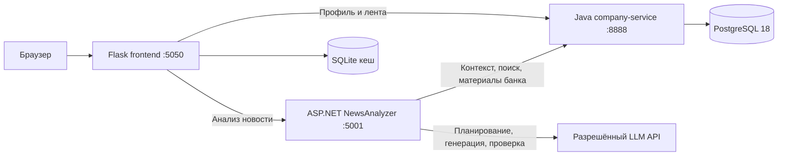

# Alfa Insight — персонализированная аналитика новостей для крупного бизнеса

**Команда «Бригада» · Альфа-Хак 2026 · Кейс «Новостная аналитика для принятия бизнес-решений»**

Alfa Insight — прототип сервиса для руководителей бизнеса: он подбирает новости с учётом должности, использует доступный контекст компании и формирует объяснение последствий события для бизнеса. Пользователь получает краткое содержание, риски, возможности, рекомендуемые действия и подтверждающие источники; экспертные материалы Альфа-Банка отделяются от выводов AI.

Проект представляет самостоятельное веб-приложение с интерфейсом, имитирующим пользовательский сценарий интернет-банка, а не интеграцию с продуктивными системами банка. Для демонстрации используются обезличенные данные кейса и/или разрешённая к передаче копия базы.

## Возможности

- Регистрация, вход, изменение профиля и выбор роли: генеральный директор (`CEO`), финансовый директор (`CFO`), главный бухгалтер (`ChiefAccountant`), руководитель казначейства (`HeadofTreasury`). Регистрация связывает аккаунт с синтетическим идентификатором физического лица `F_uid`.
- Получение данных о человеке, связанных компаниях, отраслях, регионах, банковских продуктах, платежах и деловых связях из PostgreSQL.
- Персональная новостная лента: текущий Java API отбирает новости по порогам финансовой и бизнес-значимости для должности и общей значимости; бизнес-контекст дополнительно учитывается при подробном AI-анализе.
- Импорт RSS деловых новостей и AI-обработка материалов; полнотекстовый поиск по новостям средствами PostgreSQL.
- Многошаговый AI-анализ новости: планирование исследования, получение контекста и дополнительных публикаций, обращение к банковским материалам, генерация, проверка доказательств, содержательная самопроверка и ограниченная корректировка.
- Структурированный `AnalysisResult`: `summary`, `relevanceReason`, `potentialRisks`, `potentialOpportunities`, `recommendedAction`, `bankPerspective`, `claims`.
- Проверяемые ссылки `evidenceIds` на новости (`news:`), компании (`company:`) и материалы банка (`bank:`); факты, AI-интерпретации и позиции банка различаются по `type`.
- Отдельное отображение банковской аналитики, если для неё есть подтверждающие материалы. При отсутствии источника позиция банка не выдумывается.
- Кеш ленты и готовых анализов; изоляция кеша анализа по пользователю и контексту.

## Архитектура



| Компонент | Стек | Назначение |
| --- | --- | --- |
| `frontend/` | Python 3.12, Flask, Jinja2 | Интерфейс, аккаунты, профиль, новостная лента и кеш. |
| `company-service/` | Java 21, Spring Boot, JPA/JDBC, PDFBox | Работа с клиентским контекстом, новостями, материалами банка и поиском. |
| `news-analyzer/` | .NET 9, ASP.NET Core | Самостоятельная агентная логика и контроль подтверждающих источников. |
| `postgres` | PostgreSQL 18 | Пользователи, связи, компании, платежи, новости и банковские материалы. |
| `db/init/01_hackaton.sql` | Plain SQL dump | Восстановление согласованного набора данных при первом запуске БД. |

### Агентный сценарий

1. Flask отправляет `userId` и `newsId` в C# NewsAnalyzer.
2. `ContextBuilderService` собирает роль, сведения о человеке, связанные компании и исходную новость через Java API.
3. `AnalysisPlanner` определяет дополнительные поисковые запросы, а Java выполняет полнотекстовый поиск `/api/news/search`.
4. Агент получает доступные аналитические материалы Альфа-Банка, создаёт каталог источников и формирует типизированный `AnalysisResult`.
5. `EvidenceReferenceValidator` проверяет структуру `claims` и идентификаторы источников; `AnalysisValidator` оценивает обоснованность ответа. При обнаружении проблем агент может уточнить поиск и пересоздать анализ (не более одного корректирующего цикла).
6. Flask показывает результат вместе с подтверждающими источниками. Если данных о компании недостаточно, интерфейс может сообщить об ограниченности персонализации.

## Локальный запуск из GitHub

### Требования

- Git, Docker Desktop/Engine и **Docker Compose v2**; интернет для загрузки Docker-образов и обращения к LLM.
- Действительный ключ конкурсного LLM-шлюза, поддерживающего разрешённые модели. Ключи **не входят в репозиторий**.
- Доступные локальные порты `5050`, `5001`, `8888` и порт PostgreSQL (по умолчанию `5432`, можно выбрать `5433`).
- В репозитории должен быть **разрешённый к передаче plain SQL дамп** `db/init/01_hackaton.sql`. Для команды и жюри он является частью комплекта тестовых данных. Если он поставляется отдельно по условиям конкурса, его необходимо положить по этому пути **до запуска**.

Локально устанавливать Java, Python, .NET и PostgreSQL не нужно: всё собирается в контейнерах.

### 1. Клонирование

```bash
git clone https://github.com/AlexWarn1ng/AlfaBank-Hackaton2026.git
cd AlfaBank-Hackaton2026
```

Для приватного репозитория предварительно нужен доступ GitHub.

### 2. Конфигурация

Создайте `.env` по шаблону:

```powershell
# Windows PowerShell
Copy-Item .env.example .env
```

```bash
# Linux / macOS
cp .env.example .env
```

Основные параметры:

| Переменная | Описание |
| --- | --- |
| `POSTGRES_DB` | Название создаваемой локальной базы, по умолчанию `alfa_insight`. |
| `POSTGRES_USER` | Пользователь локальной PostgreSQL, по умолчанию `alfa`. |
| `POSTGRES_PASSWORD` | Придуманный пароль локальной базы. |
| `POSTGRES_HOST_PORT` | Порт PostgreSQL на компьютере; при конфликте установите `5433`. |
| `POSTGRES_BIND_IP` | Адрес публикации PostgreSQL, рекомендуется `127.0.0.1`. |
| `FLASK_SECRET_KEY` | Постоянный секрет Flask-сессий, генерируется случайно. |
| `AI_API_KEY` | Действующий ключ для C# AI-анализатора. |
| `COMPANY_AI_API_KEY` | Действующий ключ для AI-возможностей Java. |
| `AI_BASE_URL` | Базовый URL разрешённого LLM-шлюза для C#. |

Секрет Flask можно сгенерировать так:

```powershell
python -c "import secrets; print(secrets.token_hex(32))"
```

Допускается использовать один конкурсный ключ в двух переменных, если это предусмотрено провайдером. **Не добавляйте `.env` в Git.** Внутри Docker Java и Flask обращаются к PostgreSQL по имени хоста `postgres`, а не `localhost`.

### 3. Дамп базы данных

В данном варианте запуска используется **PostgreSQL 18** и дамп `db/init/01_hackaton.sql` в формате *plain SQL*. Он заменяет прежнюю демонстрационную схему и seed; не кладите рядом `01_schema.sql` и `02_demo_seed.sql`.

Если файл создан в формате PostgreSQL Custom (`pg_dump -F c`), его необходимо восстановить через `pg_restore` или преобразовать в plain SQL: одного переименования расширения недостаточно. При подготовке дампа рекомендуется исключить содержимое `public.users`, чтобы проверяющие регистрировали свои аккаунты и в репозитории не оказались существующие логины/хеши паролей.

**Инициализация дампа выполняется только один раз — при первом создании пустого Docker volume.** Для повторной проверки на чистой базе используйте отдельный Compose project name и отдельные volumes. Не удаляйте рабочие volumes с нужными данными.

### 4. Запуск

```powershell
python scripts/preflight.py
docker compose config --quiet
docker compose up --build -d
docker compose ps
```

При первом запуске PostgreSQL импортирует `db/init/01_hackaton.sql`. Дождитесь готовности Java-сервиса после импорта.

| Адрес | Назначение |
| --- | --- |
| http://localhost:5050 | Пользовательский интерфейс |
| http://localhost:5001 | NewsAnalyzer HTTP API |
| http://localhost:8888 | Java API |
| `localhost:5432` (или выбранный порт) | PostgreSQL для локального администрирования |

Проверка:

```powershell
curl.exe http://localhost:5001/
curl.exe http://localhost:8888/api/news/get/3
docker compose exec postgres psql -U alfa -d alfa_insight -c "SELECT count(*) FROM ai_features;"
```

В последней команде замените `alfa` и `alfa_insight`, если используете другие `POSTGRES_USER`/`POSTGRES_DB`.

### 5. Сквозной сценарий для жюри

1. Откройте http://localhost:5050 и зарегистрируйте аккаунт, указав имя, email, пароль (не менее восьми символов), роль и **существующий в дампе `F_uid`**. Идентификатор для демонстрации следует выбрать из `person_company_links` (см. запрос ниже).
2. Войдите в аккаунт и откройте персональную ленту новостей. Рекомендуется проверить как минимум две роли/два профиля.
3. Откройте любую показанную новость. Сама страница статьи открывается независимо от завершения AI-анализа.
4. Дождитесь блока подробного анализа: главные выводы, причины релевантности, риски, возможности и рекомендуемое действие.
5. Посмотрите блок банковской аналитики (если к событию есть подходящий материал), `claims` и подтверждающие источники с их идентификаторами.
6. Вернитесь к той же новости: готовый результат должен загрузиться из кеша.
7. Смените роль или синтетический профиль через интерфейс и проверьте изменение набора доступных новостей и/или объяснения их значимости.

Подобрать `F_uid`, связанный с существующей компанией:

```sql
SELECT DISTINCT p.synthetic_f, p.synthetic_u
FROM person_company_links p
JOIN companies c ON c.synthetic_u = p.synthetic_u
WHERE p.synthetic_f IS NOT NULL
ORDER BY p.synthetic_f, p.synthetic_u
LIMIT 20;
```

Это можно выполнить в DBeaver либо через `docker compose exec postgres psql ...`. Пример `F_uid` не захардкожен в документации: он должен существовать в фактически поставленном дампе.

### Диагностика и остановка

```powershell
docker compose logs --tail=150 postgres
docker compose logs --tail=150 company-service
docker compose logs --tail=150 news-analyzer
docker compose logs --tail=150 frontend

docker compose down
```

- `404` для компании — проверьте связь `person_company_links.synthetic_u` с `companies.synthetic_u`.
- `502` от NewsAnalyzer — проверьте ответы внешнего LLM API, действительность ключа и логи `AnalysisPlanner`/`AnalysisService`.
- Ошибки таблиц — убедитесь, что `01_hackaton.sql` импортировался в **пустой** PostgreSQL volume.
- Отсутствие `bankPerspective` допустимо, если релевантной банковской аналитики в найденных материалах нет.

**Внимание:** `docker compose down -v` удаляет Docker volumes с PostgreSQL и кешем. Используйте команду только для одноразового тестового окружения после сохранения нужных данных.

## API и формат анализа

| Компонент | Метод и маршрут | Назначение |
| --- | --- | --- |
| Java | `GET /api/news/{fid}/{position}` | Отбор ID новостей для роли. |
| Java | `POST /api/news/get` (`text/plain`) | Получение новостей по ID. |
| Java | `POST /api/news/search` (`application/json`) | Полнотекстовый поиск связанных публикаций. |
| Java | `GET /api/company/{uid}` | Контекст компании и связей. |
| Java | `GET /api/analysis-context/users/{userId}` | Персональный контекст. |
| Java | `GET /api/opinions/get` | Аналитические материалы банка. |
| Java | `POST /api/news/rss/import` | Импорт RSS и AI-обработка. |
| C# | `GET /` | Проверка доступности HTTP-процесса. |
| C# | `POST /api/analysis` | Агентный анализ по `userId`, `newsId`. |
| Flask | `GET /feed`, `GET /news/<id>` | Лента и просмотр статьи. |
| Flask | `POST /news/<id>/analysis` | Анализ выбранной новости через пользовательскую сессию. |

Пример запроса к C#:

```json
{"userId":"00000000-0000-0000-0000-000000000001","newsId":218}
```

Это **формат запроса**, а не гарантированно существующий пользователь: используйте UUID аккаунта, созданного при регистрации, и ID реальной новости в дампе.

Пример структуры ответа (сокращённый):

```json
{
  "analysis": {
    "summary": "Краткое содержание",
    "relevanceReason": "Причина важности для клиента",
    "potentialRisks": ["Риск"],
    "potentialOpportunities": ["Возможность"],
    "recommendedAction": "Следующий шаг",
    "bankPerspective": null,
    "claims": [
      {"statement":"Вывод", "type":"inference", "evidenceIds":["news:218"]}
    ]
  },
  "sources": [
    {"sourceId":"news:218", "sourceType":"news", "title":"Название источника"}
  ],
  "hasCompany": true,
  "contextNotice": null
}
```

`bankPerspective` при наличии подтверждённого материала имеет вид `{ "summary": "...", "evidenceIds": ["bank:42"] }`. `claims.type` принимает `fact`, `inference`, `bank_opinion`. Внутренние `SourceId` — идентификаторы записей; URL публикаций доступны не для всех источников.

## Данные, зависимости и воспроизводимость

- Исходные CSV кейса содержат обезличенные данные компаний, физических лиц, их связей и платежей; аналитические материалы Альфа-Банка предоставлены отдельно. Для локального запуска используется передаваемый командой согласованный SQL-дамп; его распространение должно соответствовать условиям конкурса.
- В репозитории должны находиться `compose.yaml`, Dockerfile каждого сервиса, `.env.example`, `db/init/01_hackaton.sql` (или согласованный способ его получения), `THIRD_PARTY_NOTICES.md` и файлы фиксации зависимостей.
- Базовые среды: Python 3.12, Java 21, .NET 9, PostgreSQL 18. Python-зависимости указаны в `frontend/requirements.txt`, Java — в `company-service/pom.xml`, .NET — в `NewsAnalyzer.csproj`. Для максимально строгой воспроизводимости используются lock-файлы/закреплённые версии транзитивных зависимостей и версии Docker-образов.
- Для работы AI необходим внешний конкурсный LLM API и разрешённые кейсом модели (Gemma 4 26B, GLM-5.3-Flash, Qwen3.6 35B, DeepSeek-V4.1-Flash, Qwen3-VL, Kimi K2.6). Логика агента реализована внутри проекта, а не через внешнюю готовую агентную платформу.
- Используемые сторонние библиотеки, модели, источники данных, сервисы и характер имитации банковского интерфейса описаны в [`THIRD_PARTY_NOTICES.md`](THIRD_PARTY_NOTICES.md).

### Локальные проверки

```powershell
# Python (при наличии тестового окружения)
python -m pytest frontend/tests -q

# Java
cd company-service
./mvnw test

# C# (из корня репозитория)
dotnet build news-analyzer/NewsAnalyzer/NewsAnalyzer.csproj

# Интеграция
docker compose config --quiet
docker compose up --build -d
```

## Безопасность и доступ для жюри

- `.env`, ключи LLM и реальные пароли не размещаются в Git. Для проверяющих предоставляется `.env.example`; рабочие ключи передаются отдельно по согласованному защищённому каналу.
- Пользовательские пароли хранятся в виде хешей; при подготовке дампа исключаются действующие тестовые аккаунты, если их передача не согласована.
- Сервисы в Docker публикуют порты только на `127.0.0.1`; пользовательские маршруты Flask проверяют сессию. Локальная публикация портов не заменяет защиту внутреннего API при промышленном развёртывании.
- Если репозиторий приватный, аккаунту жюри **`alfa-hack-2026`** необходимо предоставить доступ через GitHub.
- Финальная версия фиксируется **commit SHA и/или Git-тегом** до дедлайна; именно она считается версией сдачи.

```bash
git rev-parse HEAD
git tag -a hackathon-final-2026 -m "Final hackathon submission"
git push origin hackathon-final-2026
```

## Возможные улучшения

- Тематический поиск и ранжирование аналитических материалов Альфа-Банка вместо выборки первых записей.
- Дополнительные факторы персонализации непосредственно при формировании новостной ленты: индустрия, структура группы компаний, контрагенты и финансовые показатели.
- Постоянная история агентных исследований и `ExecutionLog`, просмотр выполненных шагов и промежуточных результатов.
- Уточняющие вопросы по готовому анализу и кликабельные ссылки на первоисточники.
- Метрики качества персонализации и фактической точности, мониторинг задержек, токенов и стоимости; проверка на новых новостях.
- Межсервисная авторизация, CSRF-защита, ограничения частоты запросов и расширенная защита от prompt injection.
- Полная фиксация транзитивных зависимостей, CI-тестирование и нагрузочное тестирование.
