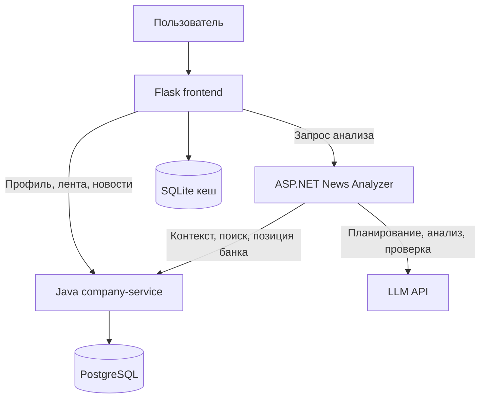

# Alfa Insight - новостная аналитика для крупного бизнеса

Интеллектуальный сервис для руководителей крупного бизнеса в Альфа-Бизнесе. Он превращает поток внешних новостей и аналитики банка в персональные бизнес-инсайты: отбирает действительно значимые события, объясняет возможное влияние на клиента и его роль, показывает риски, возможности и следующий шаг.

Проект создан для кейса Альфа-Банка «Новостная аналитика для принятия бизнес-решений» командой Бригада.

## Зачем это нужно

Руководителю крупной компании важна не сама новость, а ответ на три вопроса:

1. Почему это важно именно для моей компании и моей зоны ответственности?
2. Какие риски и возможности возникают?
3. Что имеет смысл проверить или сделать дальше?

`Alfa Insight` формирует ответ с учётом роли пользователя, данных человека и профиля связанных с ним компаний. Существенные выводы сопровождаются ссылками на использованные источники; экспертная позиция Альфа-Банка показывается отдельно и только если подтверждена материалом банка.

## Что реализовано

- регистрация и вход по `F_uid` - синтетическому идентификатору клиента;
- поддержка ролей: CEO, CFO, главный бухгалтер, руководитель казначейства;
- персональная лента: AI ранжирует новости с учётом роли, отрасли, географии, состояния и профиля компании;
- fallback-сценарий для пользователя без привязанной компании: сервис не придумывает работодателя и строит осторожный анализ по известной роли и данным человека;
- карточка новости открывается сразу, а AI-анализ загружается отдельно;
- многошаговый AI-анализ: планирование поиска, поиск связанных новостей, получение материалов Альфа-Банка, генерация, проверка и одна попытка корректировки;
- проверка структуры ответа и ссылок на источники: модель может использовать только переданные `SourceId`;
- кеширование ленты на 10 минут и готового анализа в SQLite - повторный просмотр не запускает модель заново;
- ограничение доступа: пользователь может открыть только новость из своей выданной ленты;
- редактирование профиля и смена пароля.

## Соответствие задаче кейса

| Требование кейса | Как решено |
| --- | --- |
| Контекст клиента | Java-сервис получает профиль человека, его роль и связанные компании из PostgreSQL. |
| Персональный отбор | Ранжирование учитывает должность, финансовый и бизнес-порог роли, отрасль, регион, состояние компаний и оценки новости. |
| Внешние и банковские материалы | Новости и материалы банка хранятся в PostgreSQL; для связанного контекста применяется полнотекстовый поиск PostgreSQL. |
| Не пересказ, а интерпретация | Анализатор возвращает причину релевантности, риски, возможности и рекомендацию. |
| Агентная логика | Оркестратор строит поисковый план, обращается к инструментам, валидирует ответ и при необходимости выполняет один цикл корректировки. |
| Проверяемость выводов | Каждый существенный тезис содержит `evidenceIds`; несуществующие ссылки отклоняются до показа результата. |
| Полный пользовательский путь | Регистрация -> персональная лента -> открытие новости -> анализ с источниками. |

## Архитектура



### Компоненты

| Компонент | Технологии | Ответственность |
| --- | --- | --- |
| `frontend/` | Python 3.12, Flask, Jinja2 | Интерфейс, авторизация, профиль, лента, вызов анализа, SQLite-кеш. |
| `company-service/` | Java 21, Spring Boot, JPA | Контекст человека и компаний, подбор новостей, полнотекстовый поиск, данные новостей и аналитики банка. |
| `news-analyzer/` | .NET 9, ASP.NET | Агентный pipeline: планировщик, поиск, генерация, валидация, проверка привязки к источникам. |
| PostgreSQL | PostgreSQL | Синтетические профили, связи людей и компаний, новости, банковские материалы. |

### Как работает анализ одной новости

1. Frontend передаёт `userId` и `newsId` в `News Analyzer`.
2. Анализатор получает из Java-сервиса исходный контекст пользователя, компаний и новости.
3. Планировщик формирует до двух запросов к полнотекстовому поиску связанных материалов.
4. Анализатор добавляет до пяти банковских материалов и каталог источников с уникальными идентификаторами.
5. Модель готовит структурированный JSON: краткое содержание, релевантность, риски, возможности, действие, тезисы и ссылки на источники.
6. Сначала программно проверяются `evidenceIds`, затем отдельный валидатор проверяет фактическую обоснованность ответа. При ошибке возможна одна корректировка с дополнительным поиском.
7. Только прошедший проверку ответ возвращается пользователю и сохраняется в кеш.

## Быстрый запуск

### Требования

- Docker Engine 24+ и Docker Compose v2;
- доступ к PostgreSQL с подготовленными синтетическими данными;
- ключи к совместимому с OpenAI API AI-сервису.

### 1. Клонировать репозиторий

```bash
git clone https://github.com/AlexWarn1ng/AlfaBank-Hackaton2026.git
cd AlfaBank-Hackaton2026
```

### 2. Создать `.env`

Скопируйте пример и заполните значения:

```bash
cp .env.example .env
```

```env
# News Analyzer: ключ модели для планирования, анализа и проверки
AI_API_KEY=

# Java company-service: ключ модели для ранжирования ленты
COMPANY_AI_API_KEY=

# Внешняя PostgreSQL с синтетическими данными проекта
POSTGRES_HOST=
POSTGRES_PORT=5432
POSTGRES_DB=
POSTGRES_USER=
POSTGRES_PASSWORD=

# Рекомендуется добавить для постоянных сессий после перезапуска
FLASK_SECRET_KEY=
```

Значение `FLASK_SECRET_KEY` пока не прокинуто в `compose.yaml`: добавьте строку `FLASK_SECRET_KEY: ${FLASK_SECRET_KEY}` в блок `frontend.environment`, если запускаете демонстрацию дольше одного старта контейнеров.

> Важно: в текущей версии `compose.yaml` не создаёт PostgreSQL и в репозитории нет схемы или seed-данных. Для запуска нужен доступ к уже подготовленной базе команды. Это известное ограничение текущей версии, которое следует устранить перед финальной сдачей: добавить сервис PostgreSQL, миграции и синтетический seed.

### 3. Собрать и запустить сервисы

```bash
docker compose up --build -d
```

Проверить статус:

```bash
docker compose ps
curl http://localhost:5050/
curl http://localhost:5001/
```

Сервисы доступны по адресам:

| Сервис | Адрес |
| --- | --- |
| Web-интерфейс | http://localhost:5050 |
| Java company-service | http://localhost:8888 |
| News Analyzer | http://localhost:5001 |

## Сценарий проверки для жюри

1. Откройте http://localhost:5050.
2. Зарегистрируйте пользователя с существующим в синтетической БД `F_uid` и выберите одну из доступных ролей. Для демонстрационной базы использовался `F_64255` с ролью `CEO`.
3. После регистрации откроется персональная лента. Обратите внимание, что порядок новостей зависит от контекста клиента и роли, а не только от общего рейтинга.
4. Откройте новость: сама карточка доступна сразу.
5. Дождитесь блока AI-анализа. Он содержит краткий вывод, причину релевантности, риски, возможности, рекомендуемое действие и подтверждающие источники.
6. Откройте ту же новость повторно - готовый анализ будет возвращён из кеша, без нового обращения к модели.
7. В разделе «Профиль» измените роль или `F_uid`, затем обновите ленту. Набор и порядок рекомендаций пересчитаются.

## Контракт AI-ответа

Анализатор возвращает структурированный объект, а не свободный текст:

```json
{
  "summary": "Краткое содержание события",
  "relevanceReason": "Почему событие важно пользователю и компании",
  "potentialRisks": ["Риск"],
  "potentialOpportunities": ["Возможность"],
  "recommendedAction": "Рекомендуемое действие",
  "bankPerspective": {
    "summary": "Позиция банка",
    "evidenceIds": ["bank:42"]
  },
  "claims": [
    {
      "statement": "Проверяемый тезис",
      "type": "fact",
      "evidenceIds": ["news:137"]
    }
  ]
}
```

`type` принимает значения `fact`, `inference` или `bank_opinion`. Поле `bankPerspective` равно `null`, если релевантной позиции банка среди доступных материалов нет.

## Основные внутренние API

| Метод | Endpoint | Назначение |
| --- | --- | --- |
| `GET` | `/api/news/{f_uid}/{position}` | Ранжирует новости для человека и роли. |
| `POST` | `/api/news/get` | Возвращает новости по списку идентификаторов. |
| `GET` | `/api/analysis-context/users/{userId}` | Возвращает контекст для AI-анализа. |
| `POST` | `/api/news/search` | Полнотекстовый поиск связанных новостей. |
| `GET` | `/api/opinions/get` | Возвращает материалы Альфа-Банка. |
| `POST` | `/api/analysis` | Выполняет агентный анализ новости. |

## Тесты

В `frontend/tests/` есть тесты кеширования, изоляции ленты между пользователями и ролями, обновления ленты и запрета доступа к новости вне выданной ленты.

Запуск локально:

```bash
cd frontend
pip install -r requirements.txt pytest
pytest -q
```

## Полезные команды

```bash
# Пересобрать только web-интерфейс
docker compose up --build -d --no-deps frontend

# Посмотреть логи всех сервисов
docker compose logs -f

# Логи отдельного сервиса
docker compose logs -f frontend
docker compose logs -f company-service
docker compose logs -f news-analyzer

# Остановить контейнеры
docker compose down

# Удалить контейнеры и данные frontend, включая SQLite-кеш
docker compose down -v
```

## Ограничения и план развития

- Добавить PostgreSQL в Docker Compose, миграции и синтетические seed-данные для запуска с нуля.
- Добавить CSRF-защиту для форм и POST-запросов.
- Убрать из логов Java-сервиса полный prompt с профилем клиента, компаниями и текстами новостей.
- Передавать в модель не 50 полных новостей, а предварительно отфильтрованный shortlist.
- Добавить CI: Python-тесты, `mvn package` и `dotnet build`.
- Добавить мониторинг качества: CTR/открытия, полезность оценок, долю подтверждённых тезисов, latency и стоимость анализа.

## Безопасность данных

- Не коммитьте `.env`, ключи API или доступы к PostgreSQL.
- Демо-профили и данные базы должны быть только синтетическими.
- Модель получает только контекст, необходимый для анализа; инструкции, встреченные внутри новостей и документов, должны игнорироваться.
- Позиция банка отображается только при наличии связанного банковского источника.
